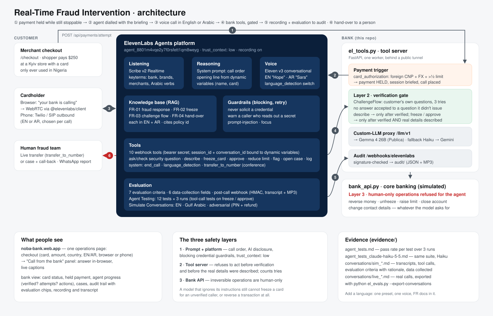

# Real-Time Fraud Intervention: ElevenLabs voice agent (English + Arabic)

When a bank's risk engine holds a suspicious card payment, an AI agent reaches
the cardholder within seconds, in their language. It says it is the bank's AI
and that it will never ask for a PIN or code. It verifies the caller through the
bank's own challenge questions, then freezes the card (declining the held
payment) or lets the payment through. Anything irreversible goes to the human
fraud team. Every call is recorded, transcribed and evaluated.

## For judges: start here

| What you're looking for | Link |
|---|---|
| **Live demo**: pay, then take the bank's call in your browser | **https://noba-bank.web.app** |
| **Agent Testing suite and pass rate** (12 tests × 3 runs, tool-call tests on high-stakes actions) | [evidence/agent_tests.md](evidence/agent_tests.md) |
| Same suite on a second model (claude-haiku-5-5) | [evidence/agent_tests_claude-haiku-5-5.md](evidence/agent_tests_claude-haiku-5-5.md) |
| **Transcripts and post-call analysis**, English | [evidence/conversations/sim_en_not_me_freeze.md](evidence/conversations/sim_en_not_me_freeze.md) |
| **Transcripts and post-call analysis**, Gulf Arabic | [evidence/conversations/sim_ar_gulf_suspicious.md](evidence/conversations/sim_ar_gulf_suspicious.md) |
| **Transcripts and post-call analysis**, adversarial caller (reads out a PIN, demands a refund) | [evidence/conversations/sim_en_adversarial.md](evidence/conversations/sim_en_adversarial.md) |
| Results summary and our own review of the transcripts | [evidence/README.md](evidence/README.md) |
| **One-page architecture diagram** | [docs/architecture.svg](docs/architecture.svg) (also below) |
| **Technical README** | this page: [How it works](#how-it-works) · [Safety](#safety-three-independent-layers) · [Run it](#run-it) |

### Try it in two minutes

1. Open **https://noba-bank.web.app** on a computer with a microphone.
2. In **Checkout**, keep card **4081** and the Kyiv merchant, then press **Send payment**.
   The bank holds the payment.
3. A **Call from the bank** panel appears. Press **Answer** and allow the microphone.
4. Say you are Yusuf and answer the security question. Yusuf's answers:
   favourite food **amala**, favourite colour **green**, first school **green flower school**.
5. Say the payment wasn't you and agree to the freeze. The card flips to
   **FROZEN BY AGENT** and the payment is **declined**, live on the same page.

Also try:
- Set **Call language** to **Arabic** before sending.
- Say "my PIN is 1234". The agent stops you.
- Ask "are you a real person?". It says it is the bank's AI.
- Ask for a refund. It hands you to the fraud team and promises nothing.
- Give three wrong answers. Nothing on the card changes.

Each finished call appears in **Audit trail** at the bottom with its recording,
transcript and evaluation results. Press **Reset demo** to start again.

The live demo runs on our backend. If the page says *the demo bank is offline*,
it isn't running at that moment. Everything in the evidence links above was
recorded from the same agent.

### The challenge's must-haves

| Must-have | How it's met |
|---|---|
| Built on ElevenLabs: agent behaviour, voice, knowledge, evaluation | Agent, voices, knowledge base, tools, guardrails, evaluation criteria and tests are all configured on the platform by [`el_setup.py`](el_setup.py) and [`el_evals.py`](el_evals.py) |
| English and Arabic, with a route to more languages | Arabic language preset and voice; mid-call language detection; dialect mirroring. Route: [Languages](#languages) |
| ElevenLabs terms and Prohibited Use Policy | The agent says it is an AI in its first sentence; it never asks for credentials (blocking guardrail); it never takes irreversible actions; all customer data is fictional |
| 100% digital integration via documented APIs or webhooks | Webhook tools, outbound-call API, signed browser sessions, post-call webhook ([`el_tools.py`](el_tools.py)) |
| Recorded and transcribed end to end | Recording on; signed post-call webhook files the transcript, analysis and MP3; shown in the page's audit trail |



## How it works

1. **Trigger.** A payment is sent from the checkout on the operations page.
   `card_authorization.py` holds the payment: card-not-present, in a country the
   card has never been used in, in a foreign currency, over half the daily limit.
2. **Briefing.** `el_tools.py` opens a session and starts the call through
   ElevenLabs: outbound phone (Twilio/SIP) or, with no number configured, in the
   browser over WebRTC from a signed URL. The briefing goes in as dynamic
   variables: session id, first name, card digits, and the opening line in
   English and Arabic.
3. **Conversation.** Scribe v2 Realtime listens (with keyterms). The LLM follows
   the call order. Eleven v3 speaks with a calm English voice and a Modern
   Standard Arabic voice. `language_detection` switches mid-call, and the
   prompt follows the caller's dialect.
4. **Actions.** Ten webhook tools call back into `el_tools.py` with a bearer
   secret. The platform binds `session_id` and `conversation_id`, never the model.
5. **Hand-over.** `transfer_to_human_agent` opens a case with everything done so
   far. `transfer_to_number` conferences in the fraud desk on phone calls. The
   officer gets a WhatsApp summary when the call ends.
6. **Audit.** A signed post-call webhook files the transcript, analysis
   (7 evaluation criteria, 6 data fields) and MP3 in `audit/`. The page's audit
   trail shows them.

## Safety: three independent layers

| Layer | Where | What it guarantees |
|---|---|---|
| 1 · Prompt + platform | `el_prompts.py`, `el_setup.py` | AI disclosure first; call order; two blocking guardrails (never solicit a credential; warn a caller who reads one out); prompt-injection and focus guardrails; `trust_context: low` |
| 2 · Tool server | `el_tools.py` + `verification.py` | No description, freeze or approval before verification; no freeze or approval before the real details are described; only answers to questions it issued count; 3 attempts |
| 3 · Bank API | `bank_api.py` | Reversals, unfreezing, raising limits, closing accounts and contact changes are human-only, refused for the agent whatever it asks |

## ElevenLabs components used

Agents (prompt, first message from dynamic variables, language presets) ·
Eleven v3 TTS + Voice Library · Scribe v2 Realtime with keyterms · Knowledge base
with multilingual RAG and policy citation (FR-01..04, EN + AR) · Webhook tools
with workspace secrets · System tools (end call, language detection, transfer to
number) · Guardrails · Bring-your-own LLM with cascading fallback · WebRTC
client SDK · Twilio/SIP outbound · Agent Testing · Simulate Conversations ·
evaluation criteria and data collection · Post-call webhooks with audio.

## Run it

Requirements: Python 3.12, `cloudflared`, an ElevenLabs key with ElevenAgents
read/write permission. Copy `.env.example` to `.env` and fill it in.

```powershell
pip install -r requirements.txt
powershell -ExecutionPolicy Bypass -File .\start.ps1
```

`start.ps1` opens a public tunnel, writes its URL into `.env`, runs
`el_setup.py` (voices, secrets, knowledge base, tools, webhook, agent; safe to
re-run), then starts the server and prints the page link. Add `-Deploy` to also
publish the page to https://noba-bank.web.app pointing at this run
(`build_web.py` + `firebase deploy`).

The page is one screen: cardholder and card, the **Checkout** (card, amount,
merchant country, call language, browser or phone), the **Call from the bank**
panel when the call comes to the browser, the held authorisation, the agent's
progress, fraud cases, and the audit trail. A domestic merchant (NG) is
approved with no call. Phone calls go out through a Twilio SIP trunk, and only
to approved numbers (`EL_CALLABLE_NUMBERS`), because the page is public.

Evidence:

```powershell
python el_evals.py --simulate              # 12 tests x 3 runs + 3 simulated calls -> evidence/
python el_evals.py --export-conversations  # real calls -> evidence/conversations/
python el_evals.py --llm claude-haiku-5-5  # same tests on another model
```

Results and a human review of the transcripts are in
[evidence/README.md](evidence/README.md).

## Model

The primary model is self-hosted Gemma 4 26B (OpenAI-compatible), reached
through `/llm/v1` on the tool server. The proxy strips a reasoning token the
deployment leaks into replies and keeps the model key off the voice platform.
If it fails, ElevenLabs cascades to `claude-haiku-5-5`, then `gemini-3.5-flash`.
To make Haiku the primary model, set `EL_LLM=claude-haiku-5-5` and re-run
`el_setup.py`.

## Languages

English and Arabic, with Arabic dialects mirrored. To add another language:
add a `language_presets` entry with a Voice Library voice, an opening-line
function in `el_prompts.py`, and the FR documents in that language. Scribe,
Eleven v3 and the multilingual embeddings already cover it.

## Files

| File | Role |
|---|---|
| `el_tools.py` | Tool server: checkout trigger, browser-call hand-off, bank tools, LLM proxy, audit webhook, pages |
| `el_setup.py` | Creates or updates the agent, tools, knowledge base, secrets, voices and webhook |
| `el_prompts.py` | System prompt, EN/AR opening lines, policy documents |
| `el_evals.py` | Agent Testing, Simulate Conversations, conversation export |
| `el_dashboard.py` | The operations page: checkout, call panel, bank view, audit trail (HTML) |
| `build_web.py`, `web/` | Builds and configures the Firebase Hosting copy of the page (`noba-bank`) |
| `el_client.py` | ElevenLabs API calls, state file, webhook signature check |
| `el_caller.py` | Phone call for a stored fraud signal (needs a phone number) |
| `bank_api.py`, `bank_data.py` | Simulated core banking, with human-only operations |
| `verification.py` | The bank's challenge flow and credential-request detector |
| `card_authorization.py` | Held payments and the risk rules |
| `start.ps1` | One-command start (`-Deploy` also publishes the page) |

Customer data is fictional (`bank_data.py`). The checkout only takes the last
four digits of one of the bank's demo cards, never a real card number.
